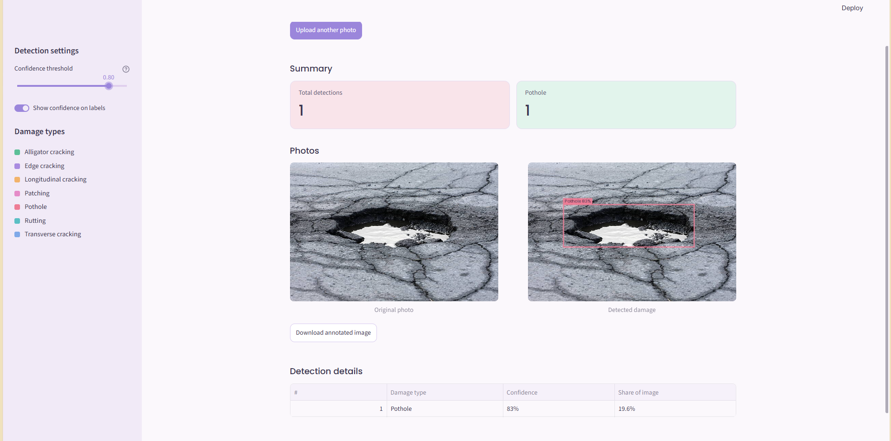

# Road Damage Detection

A web app that finds potholes and road cracks in a photo. Upload a road image and get annotated results, damage counts and a details table on a separate results page.

**Live demo:** https://road-damage-detection-kzlp9ws9pxg7pevsaop8xt.streamlit.app/




## Features

- Detects potholes and several crack types (alligator, transverse, longitudinal, edge), patching and rutting
- Combines two YOLOv8 models and removes duplicate boxes
- Adjustable confidence threshold (default 0.50)
- Separate results page with summary cards, original and annotated photos, and a details table
- Download the annotated image as a PNG
- Supports JPG, PNG, WEBP and AVIF uploads

## Tech stack

- **Model:** YOLOv8n (Ultralytics), trained in Google Colab
- **Dataset:** Roboflow Universe road damage dataset (road-damage-det, v4)
- **App:** Streamlit, Pillow, pandas

## Run it locally

```bash
git clone <your-repo-url>
cd <your-repo-folder>

python -m venv venv
venv\Scripts\activate          # Windows
# source venv/bin/activate     # macOS / Linux

pip install -r requirements.txt
streamlit run app.py
```

The model files `road_best.pt` and `pothole_best.pt` must sit in the project root.

## Project structure

```
├── app.py              # Upload page
├── common.py           # Theme, models, detection and drawing helpers
├── pages/
│   └── Results.py      # Results page
├── .streamlit/
│   └── config.toml     # Pastel theme
├── road_best.pt        # Road damage model weights
├── pothole_best.pt     # Pothole model weights
└── requirements.txt
```

## How to use it

1. Upload a road photo on the first page.
2. The app opens the results page automatically.
3. Use the sidebar slider to raise the threshold (fewer false boxes) or lower it (catch more damage).
4. Download the annotated image or upload another photo.

## Limitations

- The model only knows road damage. On unrelated images it can return false detections.
- Crack classes are less reliable than potholes, so weak detections can appear on smooth asphalt.
- Photos taken from above or from a vehicle dashboard work best.
- Results are automated estimates. Verify on site before any maintenance decision.

## Future improvements

- Train a larger model (YOLOv8s) for longer to improve confidence and crack accuracy
- Batch upload for several photos at once
- Export results as a CSV or PDF report

## Author

Built by Luckmitha.
